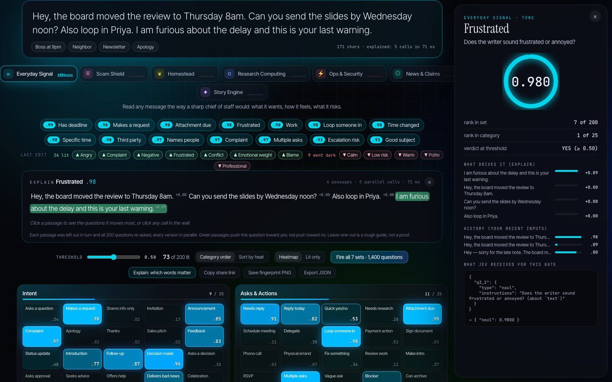
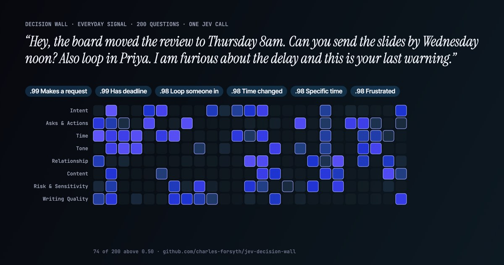

<div align="center">

# Decision Wall

### Don't ask one big question. Ask 200 small ones at once.

An independent, open-source experiment in a way of using models like [TypeSafe's Jev](https://typesafe.ai): break a judgment into many small yes/no questions, ask them all in **one parallel call** (a few hundred milliseconds), and let your code decide what counts.

<sub>Not affiliated with or endorsed by TypeSafe. Jev is their model; Decision Wall is my experiment with it.</sub>

[](https://github.com/charles-forsyth/jev-decision-wall/actions/workflows/ci.yml)


[](https://doi.org/10.5281/zenodo.23874577)
[](LICENSE)

**[▶ Try it now, no key needed](https://charles-forsyth.github.io/jev-decision-wall/app/)** · [Watch the 70-second demo](https://charles-forsyth.github.io/jev-decision-wall/#demo) · [Quick start](#quick-start) · [How it works](#how-it-works) · [Question sets](#seven-question-sets)


</div>

---

## Why this exists

The idea: when you need a judgment about some text (is this a scam? does this ticket need a human? is this claim checkable?), don't ask a model one big open question. Ask many small, concrete ones, get a probability for each, and let ordinary code combine them. You can see every piece of evidence, change the rules without re-asking, and test the questions one by one.

That only works if asking many questions is cheap and fast, which is what TypeSafe's Jev is built for. Most AI models write. **Jev answers.** It's a "System One" model: give it some text and a list of questions, and it returns a calibrated probability for each one. No prose, no reasoning chains, just typed answers your code can use.

The surprising part is **width**. Asking 200 questions about one text costs almost the same time as asking one:

| questions in one call | latency (measured) | per question |
|---:|---:|---:|
| 1 | ~185 ms | 185 ms |
| 50 | ~200 ms | 4 ms |
| 200 | **~150–300 ms** | **~1.5 ms** |

Decision Wall makes that visible. Every cell on the wall is a separate question. They all go out together, come back together, and light up in about the time it takes to blink.

## What you can do

- **Type and watch it think.** The wall recalculates every time you pause typing (~0.4 s). Add *"...and I smell gas"* to a sentence about a truck that won't start, and the safety panel lights up.
- **Paste anything.** An email, a scam text, a log line, a news post, a story pitch.
- **Click any cell** to see the exact question, its probability, its rank, and how it changed across your recent inputs.
- **Slide the threshold.** The wall re-sorts instantly with **no new call**: the model gives probabilities once, your code decides what counts.
- **Fire all 7 sets.** 1,400 questions across seven parallel calls, drawn as a live race, with the measured wall clock next to what the same calls would take one after another. Measured: **1,400 answers in 282 ms, against 1,092 ms back to back.**
- **Explain: which words matter.** Leaves each sentence out in turn and re-asks all 200 questions, every version in parallel. The text lights up green or red for whichever question you pick: *"I am furious about the delay"* drives **Frustrated +0.89** while the scheduling sentences contribute nothing. One call per sentence plus one for the full text (5 for that email, at most 13), all in parallel: ~300 ms.
- **See what flipped.** After every edit, a strip shows which questions just crossed the threshold and which went dark.
- **Share the exact result.** *Copy share link* encodes all 200 answers in the URL (one byte each), so the link replays the result with no key and no server. **The link contains your text** (up to 1,500 characters), so anyone you send it to, and any chat app that previews it, can read it. Answers in a shared link are shown as "from a shared link (not re-checked)": a link can be edited, so it isn't proof of what Jev said. *Save fingerprint PNG* draws the whole wall as a 1200×630 card; *Export JSON* gives you every question and probability.
- **Try it without a key.** The [hosted copy](https://charles-forsyth.github.io/jev-decision-wall/app/) plays real Jev answers recorded for every sample against every set (`npm run record` regenerates them).

<table>
<tr>
<td width="50%"><br><sub><b>Scam Shield</b> on a grandparent scam: <i>Grandparent scam .98, Gift cards .98, Urgency .98</i></sub></td>
<td width="50%"><br><sub><b>The wall:</b> 8 categories × 25 questions, brightness = probability</sub></td>
</tr>
<tr>
<td><br><sub><b>Click a cell:</b> the exact question, score, rank and history</sub></td>
<td><br><sub><b>Parallel burst:</b> 7 lanes race; all at once vs one after another</sub></td>
</tr>
<tr>
<td><br><sub><b>Explain:</b> which sentence drives <i>Frustrated</i> (+0.89), leave-one-out in parallel</sub></td>
<td><br><sub><b>Fingerprint PNG:</b> the whole result as one shareable card</sub></td>
</tr>
</table>

## Quick start

You need **Node 20+** and a **TypeSafe API key** ([typesafe.ai](https://typesafe.ai)). No `npm install`; there are zero dependencies.

```bash
git clone https://github.com/charles-forsyth/jev-decision-wall.git
cd jev-decision-wall
cp .env.example .env          # then paste your key after TYPESAFE_API_KEY=
node server.js                # → http://127.0.0.1:8770
```

Or pass the key inline: `TYPESAFE_API_KEY=ts-... node server.js`

Or with Docker:

```bash
docker build -t jev-decision-wall .
docker run --rm -p 127.0.0.1:8770:8080 -e TYPESAFE_API_KEY=ts-... jev-decision-wall   # localhost only
```

**What does it cost?** Jev charges for input tokens only. One 200-question call is about 3,000–4,700 tokens, so at TypeSafe's published $0.042 per million input tokens a full wall costs roughly **$0.0002**. The server stops calling at a daily cap (default 5M tokens ≈ $0.21) and logs every call to `~/.config/jev/usage.jsonl`.

## Seven question sets

Each set is **exactly 200 unique questions** in 8 categories of 25, plus sample texts to try. Pick one from the tabs.

| Set | What it reads | Categories |
|---|---|---|
| ✉ **Everyday Signal** | Any message or email | Intent · Asks & Actions · Time · Tone · Relationship · Content · Risk · Writing Quality |
| ⛨ **Scam Shield** | Texts, emails, DMs, listings | Pressure · Impersonation · Payment Rails · Data Grab · Too Good To Be True · Language Tells · Scam Type · Verdict |
| ❦ **Homestead** | Farm and rural field notes | Animals · Wildlife & Predators · Garden & Soil · Weather · Machines · Power & Water · Safety · Tasks |
| ⌬ **Research Computing** | Researcher requests and tickets | Request Type · Workload · Data Risk · Money · Urgency · Routing · Next Step · Strategy |
| ⚡ **Ops & Security** | Log lines, alerts, CVEs | Event Type · Subsystem · Security · Severity · Root Cause · Response · Environment · Signal Quality |
| ◎ **News & Claims** | Headlines and viral posts | Topic · Claims · Framing · Style & Source · Impact · Credibility · Emotion · Reader Action |
| ✦ **Story Engine** | Scenes, pitches, dreams | Genre · Characters · Setting · Plot & Stakes · Mood · Themes · Craft · Audience & Format |

Sets are plain JavaScript files in [`public/sets/`](public/sets/). Each line is `"Short label|Full yes/no question?"`. Writing your own takes about an hour; see [CONTRIBUTING.md](CONTRIBUTING.md). `npm run check` validates the count and uniqueness.

## How it works

```
 browser                      server.js (Node, 0 deps)                TypeSafe
┌────────────┐  POST /api/jev  ┌─────────────────────────┐   1 call    ┌──────────┐
│ text box   │ ──────────────▶ │ adds your key (env/.env)│ ──────────▶ │   Jev    │
│ 200 cells  │                 │ cache · daily cap · log │ 200 yes/no  │ System 1 │
│ threshold  │ ◀────────────── │ never sends key back    │ ◀────────── │          │
└────────────┘  200 probs      └─────────────────────────┘  ~200 ms    └──────────┘
```

- Every question is a Jev **noul** (a yes/no question that returns the probability of "yes"). The page sends all 200 as one request over the same text.
- Typing is **debounced** and stale requests are **aborted**, so the wall never jumps back to an older answer.
- Answers are **cached** by set + text, so backspacing to a previous sentence costs nothing.
- The browser never talks to TypeSafe directly. The API doesn't allow cross-origin calls, and this way your key stays on the server.

## Configuration

All optional. Set as environment variables or in `.env`.

| Variable | Default | Meaning |
|---|---|---|
| `TYPESAFE_API_KEY` | – | Your key (or put it in a file at `JEV_KEY_FILE`, default `~/.config/jev/.key`) |
| `PORT` / `HOST` | `8770` / `127.0.0.1` | Where to listen. Keep localhost unless you add sign-in. |
| `JEV_DAILY_TOKEN_CAP` | `5000000` | Stop calling after this many input tokens per day (all users) |
| `JEV_USER_DAILY_TOKEN_CAP` | `1000000` | Per signed-in user (sign-in mode only) |
| `JEV_USAGE_FILE` | `~/.config/jev/usage.jsonl` | Usage log |
| `JEV_TIMEOUT_MS` | `15000` | Give up on a TypeSafe call after this long |
| `JEV_MODEL` | `jev-latest` | Model id sent to TypeSafe |
| `LOG_HASH_SALT` | random per start | Key for the text fingerprint in sign-in audit logs |
| `AUTH_HEADER` | – | Header carrying the signed-in email (e.g. `x-goog-authenticated-user-email` behind Google IAP). Turns on sign-in mode and structured audit logs. |
| `ALLOWED_DOMAIN` | – | Only allow emails at this domain |
| `NOTICE` | – | Banner text shown under the wall |

## Hosting it for a team

Local mode has **no sign-in**: anyone who can reach the port can spend your key. To share it, put sign-in in front.

> Sign-in mode trusts the `AUTH_HEADER` header, so the server must only be reachable through the proxy that sets it (on Cloud Run, IAP is the only invoker). Never expose a sign-in-mode server directly. A ready script deploys to **Google Cloud Run behind Identity-Aware Proxy**, limited to one Google Workspace domain, with the key in Secret Manager, per-user caps, and every action logged to Cloud Logging:

```bash
PROJECT=my-gcp-project DOMAIN=example.edu TYPESAFE_API_KEY=ts-... ./deploy/cloudrun.sh
```

It scales to zero, so it costs nothing when nobody is using it. Caps there are best effort: they live in memory and reset when the instance restarts, so also set a spending limit in your TypeSafe account. Sign-in mode writes an audit line per action to Cloud Logging: the user's email, the question set, text length and a keyed fingerprint of the text (not the text itself).

## Honest limits

- **Probabilities, not facts.** TypeSafe trains Jev for calibrated probabilities (we haven't measured that here), but it's a fast judgment, not research. Treat differences under ~0.1 as noise, and don't set thresholds finer than that.
- **Soft concepts under-fire** when the text only implies them. Name the concrete thing in the question ("Does it ask for gift cards?") instead of the vague one ("Is it shady?").
- **Your text goes to TypeSafe.** Read their [privacy policy](https://typesafe.ai/legal/privacy-policy) before pasting anything private.
- **Share links carry your text.** Don't share a link for anything you wouldn't paste in a chat.
- **Usage events.** The page tells its own server when you open a set, pick a sample, fire a burst or open a question (no text). In local mode those are dropped; in sign-in mode they go to the audit log.
- **Explain is leave-one-out**, a rough guide: when two sentences say the same thing, removing either one changes little, so both can look unimportant.
- Latency figures were measured on `jev-1.14` from a US home connection; yours will vary.

## Development

```bash
npm run check     # validate all question sets + run tests (no key or network needed)
npm start         # same as node server.js
npm run record    # re-record public/replays.js against the live API (~$0.04)
npm run pages     # copy public/ into docs/app/ for the no-key GitHub Pages copy
```

The tests run the server against a fake TypeSafe endpoint and check that the key never leaks, caching, caps, request limits and the sign-in gate.

## Cite

If you use or build on Decision Wall, please cite it:

> Forsyth III, C. E. (2026). *Decision Wall: ask 200 small yes/no questions at once* (Version 1.2.3) [Software]. Zenodo. https://doi.org/10.5281/zenodo.23874577

The DOI above always resolves to the newest release. GitHub's "Cite this repository" button gives BibTeX and APA from `CITATION.cff`.

## License

MIT © Charles Forsyth. Not affiliated with TypeSafe; Jev and TypeSafe are their trademarks.
